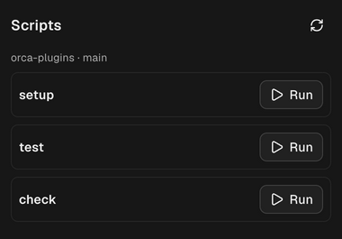

# Scripts



Runs the scripts in a worktree's `orca.yaml` on demand. Orca runs `scripts.setup` when it creates a
worktree and `scripts.archive` before removing one; this panel lets you run either again, or any
other entry you put under `scripts:`, whenever you want.

```yaml
# orca.yaml
scripts:
  setup: |
    pnpm install
  archive: echo bye
  reset-db: pnpm db:reset # any other name shows up too
```

## Install

| Plugin      | Command (macOS)                                                                                         | Install                                                                                   |
| ----------- | ------------------------------------------------------------------------------------------------------- | ----------------------------------------------------------------------------------------- |
| **Scripts** | `open "orca://plugins/eliasjnior.script-runner?catalog=https://github.com/eliasjnior/orca-plugins.git"` | [Click here to install](https://eliasjnior.github.io/orca-plugins/install/script-runner/) |

On Linux, replace `open` with `xdg-open`.

Orca opens the plugin's page: review the access it asks for and press **Install**. Other ways to
install are in the [repository README](../../README.md#install).

## How it works

- **Scripts** panel in the right sidebar: one card per script with a **Run** button. It follows the
  focused worktree and re-reads `orca.yaml` on every focus change; the refresh button re-reads it
  on demand.
- **setup** and **archive** are Orca's own lifecycle scripts and can reinstall or remove things, so
  their Run asks first: the card shows what the script is for, with **Run setup** (or **Run
  archive**) and **Cancel**. Orca's panels have no dialogs, so the question opens in the card.
  Every other script runs on the first press.
- Orca closes a panel when another sidebar tab opens. The last list of each worktree is kept, so
  coming back shows it at once while the worker re-reads `orca.yaml`.
- It reads the worktree's own `orca.yaml`, or the primary checkout's when the worktree has none.
  Invalid YAML or duplicate keys show an error, as Orca would ignore that file.
- **Run** opens a new terminal tab named after the script in that worktree, switches to it, and
  runs it the way Orca runs `setup`: Bash with `set -e`, from the worktree folder, with
  `ORCA_ROOT_PATH`, `ORCA_WORKTREE_PATH` and `ORCA_WORKSPACE_NAME` set. The command is read from
  disk again at that moment.

- The tab is opened through Orca's own `orca` CLI (found beside the running Orca app, on `PATH`,
  or in `/Applications`). Orca 1.4.247's plugin API starts terminals in the background with no tab
  at all, so its output could not be seen; that API is used only when the CLI is missing, and the
  panel then says the script is running without a tab.

## Access

- Runs a Node worker (`src/worker.ts`): reading `orca.yaml` needs the file system.
- `workspace:read`: find the focused worktree and its path.
- `terminal:send`: start the script in the background when the `orca` CLI is missing.
- The worker also runs the `orca` CLI (`orca terminal create`) to open the visible tab.

## Limits

- macOS and Linux only (scripts run with Bash).
- Workspaces on another host (SSH) are not supported: the worker reads files on this machine.
- Orca's plugin API names the focused workspace by display name and branch only; the worker matches
  that against the workspace list. Two workspaces with the same name and branch cannot be told
  apart, and the panel says so instead of guessing.
